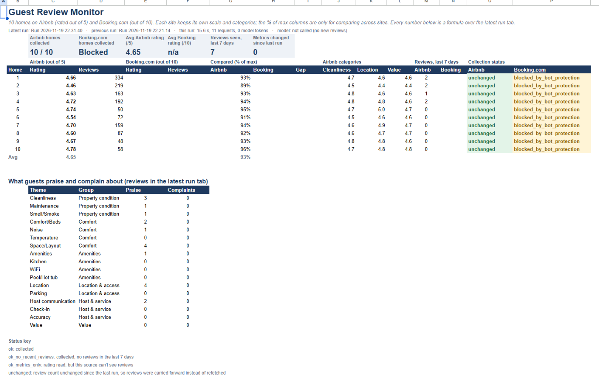

# Review Monitor: onsite rebuild

An agent that pulls guest-review data for 10 rental homes into a Google Sheet every 10 minutes. It collects everything the brief asks for from Airbnb. It collects nothing from Booking.com, which blocks scripted requests, so it reports the block and stops. In the live check, a run with 7 new reviews used 5,865 input tokens and a run with nothing new used none. My onsite version used 0.8M to 2.8M per run.

This is the agent task from my Conduit onsite on Nov 18, 2026. I rebuilt it to the same brief in about an hour, the way I worked at the onsite, with my own AI coding agents (Claude Code). Then I spent another hour having AI reviewers try to break it, fixed what they found, and ran it live, to get it close to something an engineer could pick up.

The Dashboard after two live runs 10 minutes apart on Nov 19, 2026. The Booking.com columns are blank because Booking blocks scripted requests.

## What it delivers

| Brief | How | Where |
|---|---|---|
| Rating, review count and category scores per home and site | Airbnb: read from the listing page. Booking.com: reported as blocked | Run tab |
| Reviews from the last 7 days | Airbnb's reviews query, newest first, paged past the window | Run tab |
| A tab per run, plus a summary tab with formulas | Every rating and count on the Dashboard is a formula over the latest run tab, each site on its own scale, with "% of max" to compare | `Dashboard` |
| Every 10 minutes | One command repeats on a fixed 10-minute cadence. In the live check the two runs were 10.4 minutes apart | Run tabs |
| Bonus: keep run tabs, add a changes tab | The latest 72 run tabs (12 hours) are kept and older ones deleted so the workbook stays small. `Changes` lists metrics that moved and new reviews | `Changes` |
| What guests praise and complain about | Each new review is tagged once with a sentiment and themes from a fixed list | Dashboard |

## How it works

Code collects both sites, writes the Sheet and sends alerts, in the same order every run. The model (Claude Haiku 5.5) only tags reviews it hasn't seen before. It has two tools, one that returns new review text and one that saves tags, and it never sees web pages or spreadsheet rows. When nothing is new, it isn't called. Each run checks all 10 Airbnb listing pages. If a home's review count hasn't changed, it skips the reviews query and carries its stored reviews forward, and a home that fails a run keeps its last reviews and tags, so no review is tagged twice.

The rules live in code. The Sheet isn't written until both sites are collected and every new review is tagged, and tags outside the theme list are dropped. If the model stops early, stops making progress or the API is down, a keyword tagger finishes and the run tab says so. A run tab only counts once it's fully written, so a Sheets error halfway through a run can't wipe the next run's memory. An alert goes out by email (or to `alerts.log`) when more than 30% of one site's homes fail or the Sheet can't be written. Booking's expected block doesn't count.

Review text is untrusted, and the model is told so. A review written to steer the model could at most change the tags on that run's new reviews, since the model's only tools read new reviews and save tags from the fixed list.

Booking requests identify themselves honestly and stop at the first bot challenge. Airbnb only includes rating data in pages served to browsers (I checked with an honest User-Agent), so the Airbnb collector sends a browser User-Agent and calls Airbnb's own web API. That is scraping, which is why production would use partner APIs.

## What changed from the onsite version

I didn't have time to check the onsite build. Onsite figures are as observed in Conduit's run log and the onsite Sheet.

| Onsite | Rebuild | Why |
|---|---|---|
| The model browsed pages and retyped about 170 rows into the Sheet every run | Code fetches and writes; the model only tags new reviews | Routing data through the model saved setup time and caused nearly all the cost |
| 0.8M to 2.8M input tokens and 3 to 7 minutes per run | 5,865 tokens and 25 seconds with 7 new reviews; no model call and 16 seconds with none | Roughly 140 to 480 times fewer tokens, though the onsite figure covered more work: Booking ratings and the model writing the Sheet itself |
| Booking ratings captured for 10 of 10 homes by the agent's browser; review text blocked on all 10 | Bot challenge detected and respected, so no Booking data | A browser gets past a challenge meant to keep automated traffic out. I chose not to build that |
| Summary formulas didn't fill down, so homes 2 to 10 were blank | Formulas for every home, checked by a test and the live check | The Dashboard is what the team reads |
| 6 to 7 one-off "run once" triggers left on the agent | One scheduled command, `run --every 10` | Anyone opening the agent should see one schedule |
| Rules like "never invent numbers" only in the prompt | Enforced in code | They don't depend on the model obeying |

At Haiku 5.5's list price ($0.10 per million input tokens, $0.50 per million output), the run with 7 new reviews cost under a tenth of a cent. Model cost follows new reviews, not how often the agent runs.

## Scale

Before expanding to 1,000 homes, I'd agree with operators on how late a review can arrive and still be useful, then measure requests per home, missed reviews and cost per property against that target. Polling cost grows with listings even when the model isn't called, so freshness is the first decision. The same split then holds: an orchestrator queues jobs by platform and customer, workers write to storage, and the model tags only new reviews, in batches.

The data source is what changes. Each collector is an adapter, so production can swap in a sanctioned source without touching the rest. For Booking.com that's the Connectivity partner APIs for properties a customer manages, usually reached through their channel manager or PMS, and it's the only route to Booking review text. For Airbnb it's the software-partner API for connected hosts. For operators who can export their reviews before they're connected, the next step would be an importer that uses the same review ids and shows the export time on the Dashboard.

## What I'd do next

In priority order, for whoever takes it from here:

1. Get Booking.com data through a sanctioned route. The Booking half of the brief is still empty. For properties a customer manages, that means the partner API, usually reached through their channel manager or PMS (see Scale).
2. Check the tagging before anyone acts on it. Nothing yet measures whether the complaint counts are right. I'd score the model and the keyword fallback against a small hand-labeled set: mixed reviews, negation, other languages, and reviews that try to give the model instructions.
3. Keep history. Run tabs older than 12 hours are deleted, so week-over-week trends need an archive or a database.
